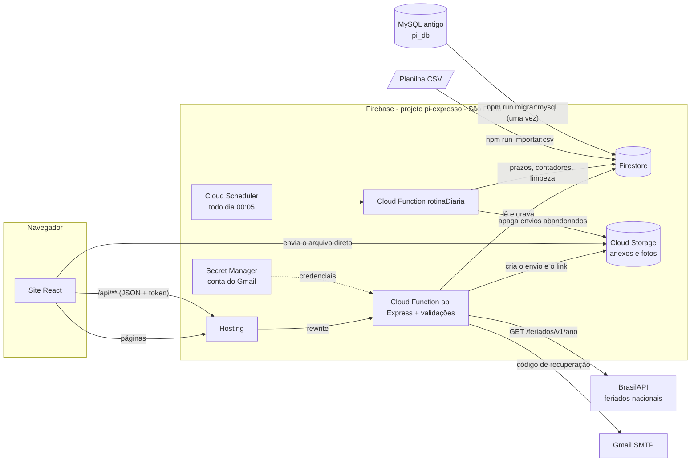
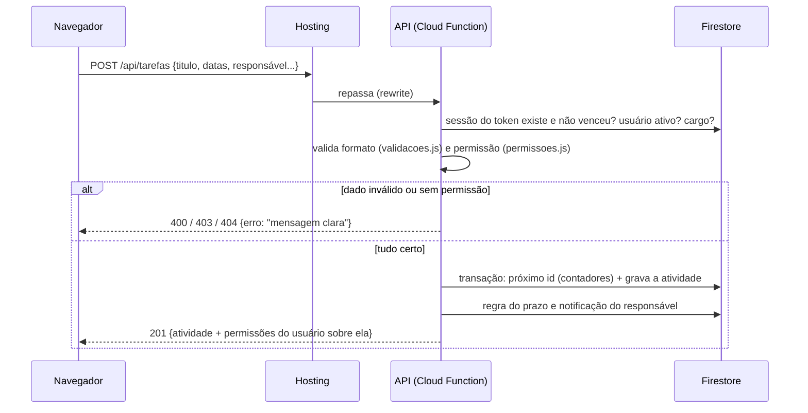

# Dados e integração — Expresso

Este documento descreve como as informações entram, são tratadas e saem do Expresso:
de onde vêm os dados, como são validados e transformados, quais regras de negócio
valem, como as inconsistências são evitadas, encontradas e corrigidas, e onde estão
as evidências de que tudo isso funciona.

- Evidências (resultado dos testes automatizados, com prints e saídas): [evidencias/relatorio-de-testes.md](evidencias/relatorio-de-testes.md)
- Instalação, rotas da API e como rodar o projeto: [README.md](../README.md)

## Sumário

1. [Visão geral do fluxo](#1-visão-geral-do-fluxo)
2. [Fontes de dados](#2-fontes-de-dados)
3. [Dicionário de dados](#3-dicionário-de-dados)
4. [Validação](#4-validação)
5. [Transformação](#5-transformação)
6. [Regras de negócio](#6-regras-de-negócio)
7. [Tratamento de inconsistências](#7-tratamento-de-inconsistências)
8. [Evidências e como reproduzir](#8-evidências-e-como-reproduzir)
9. [Limitações conhecidas](#9-limitações-conhecidas)

---

## 1. Visão geral do fluxo

O navegador nunca fala direto com o banco: as regras do Firestore e do Storage bloqueiam
qualquer acesso que não venha da API ([firestore.rules](../firestore.rules),
[storage.rules](../storage.rules)). Assim, **toda informação passa pelas mesmas validações**,
venha da tela, de um script ou de outro sistema.



**Caminho de uma requisição** (exemplo: criar uma atividade):



## 2. Fontes de dados

| Fonte | Entra por | Tratamento | Código |
|---|---|---|---|
| **Pessoas usando o site** (atividades, usuários, perfil) | API REST (`/api/...`) | Autenticação, validação de formato, permissão por cargo, padronização; resposta de erro clara | [src/controllers](../backend/src/controllers), [src/utils/validacoes.js](../backend/src/utils/validacoes.js), [src/utils/permissoes.js](../backend/src/utils/permissoes.js) |
| **Arquivos anexados** (PDF, Office, imagens, vídeo, áudio) | Direto do navegador para o Cloud Storage, por um endereço de envio criado pela API | Tipo pela extensão, tamanho real, **assinatura do conteúdo**; o que não confere é apagado | [anexoController.js](../backend/src/controllers/anexoController.js), [assinaturas.js](../backend/src/utils/assinaturas.js) |
| **Foto de perfil** | Navegador reduz para JPEG 256×256 e envia em base64 | Formato JPEG, até 512 KB, assinatura do JPEG | [perfilController.js](../backend/src/controllers/perfilController.js), [frontend utils/imagem.js](../frontend-react/src/utils/imagem.js) |
| **BrasilAPI** (feriados nacionais) | A API consulta `brasilapi.com.br/api/feriados/v1/<ano>` | Ano validado (4 dígitos); falha da BrasilAPI não derruba os relatórios (dias úteis passam a contar só os fins de semana) | [feriadoController.js](../backend/src/controllers/feriadoController.js), [pages/Relatorios.jsx](../frontend-react/src/pages/Relatorios.jsx) |
| **Planilha CSV** | `npm run importar:csv -- arquivo.csv` | Conversão e validação linha a linha; recusa com motivo; não duplica | [scripts/importarCsv.js](../backend/scripts/importarCsv.js) |
| **MySQL do backend antigo** (pi_db) | `npm run migrar:mysql` (feito uma vez, na mudança para o Firebase) | Mesmos ids, senhas e datas; padronização; tudo ou nada | [scripts/migrarMysql.js](../backend/scripts/migrarMysql.js) |
| **Relógio do sistema** (Cloud Scheduler) | Função `rotinaDiaria`, todo dia às 00:05 (horário de Brasília) | Prazos vencidos, contadores, limpeza de dados vencidos | [backend/index.js](../backend/index.js), [utils/manutencao.js](../backend/src/utils/manutencao.js) |

Saídas de dados: o e-mail com o código de recuperação de senha (Gmail, credenciais no
Secret Manager) e a exportação CSV dos relatórios ([utils/relatorios.js](../frontend-react/src/utils/relatorios.js), `exportarCsv`).

### Anexos: o arquivo não passa pela API

```mermaid
sequenceDiagram
    participant N as Navegador
    participant A as API
    participant S as Cloud Storage
    participant F as Firestore
    N->>A: POST /tarefas/7/anexos {nome, tamanho}
    A->>A: extensão permitida? até 200 MB? pode anexar nesta atividade?
    A->>S: cria sessão de envio (só para a origem do site)
    A->>F: anexo com status "enviando"
    A-->>N: url_envio
    N->>S: PUT do arquivo (direto, sem passar pela API)
    N->>A: POST /tarefas/7/anexos/{id}/concluir
    A->>S: lê o tamanho real e os primeiros 64 KB (e o fim, no Office)
    alt conteúdo não é do formato da extensão
        A->>S: apaga o arquivo
        A->>F: apaga o registro
        A-->>N: 400 "O conteúdo não corresponde a um arquivo .pdf"
    else confere
        A->>F: status "pronto" + tamanho real
        A-->>N: link de download
    end
    Note over A,S: Envio que nunca é concluído fica "enviando";<br/>a rotina diária apaga depois de 24 h
```

## 3. Dicionário de dados

Banco: **Cloud Firestore** (`(default)`, modo nativo, `southamerica-east1`). Os ids
numéricos são sequenciais, como no MySQL: o último de cada coleção fica em `contadores`
e é reservado dentro de uma transação (dois cadastros simultâneos nunca pegam o mesmo).
Datas e horas gravadas como *Timestamp* saem da API em ISO 8601 (`2026-10-20T15:04:05.000Z`);
datas de calendário (início e vencimento) são texto `AAAA-MM-DD`.

### `usuarios/{id}`

| Campo | Tipo | Regra |
|---|---|---|
| `id` | número | Sequencial (`contadores/usuarios`) |
| `nome` | texto | Obrigatório, até 150 caracteres, sem espaços nas pontas |
| `usuario` | texto ou `null` | Login opcional, até 50, só letras, números, `.`, `-` e `_`; **único** |
| `email` | texto | Obrigatório, formato `nome@dominio.tld`, até 150, **sempre minúsculo**, **único** |
| `senha` | texto | Pelo menos 6 caracteres; nunca sai da API (ver [limitações](#9-limitações-conhecidas)) |
| `setor` | `PCP`, `ENGENHARIA`, `TI` ou `null` | Define o que o gestor enxerga |
| `funcao` | `usuario`, `gestor`, `ti` | Cargo (ver [regras](#6-regras-de-negócio)) |
| `ativo` | lógico | `false` bloqueia o login e derruba as sessões na hora |
| `criado_em` | Timestamp | Hora do servidor |
| `foto_url`, `foto_caminho` | texto ou `null` | Foto em `usuarios/<id>/foto-<uuid>.jpg` no Storage |
| `tema` | `claro`, `escuro`, `profundo` | Preferência de tela |
| `cargo` | texto | Só nos migrados do MySQL (coluna antiga, guardada como histórico) |

### `tarefas/{id}` (atividades)

| Campo | Tipo | Regra |
|---|---|---|
| `id` | número | Sequencial (`contadores/tarefas`) |
| `titulo` | texto | Obrigatório, até 150, sem espaços nas pontas |
| `descricao` | texto ou `null` | Até 2000; vazio vira `null` |
| `usuario_id` | número | Responsável: usuário **existente e ativo** que quem cria pode escolher |
| `responsavel` | texto | Nome do responsável, **preenchido pela API** (não pelo navegador) |
| `participantes_ids` | lista de números | Até 20 usuários existentes e ativos, sem repetição |
| `participantes` | texto ou `null` | Nomes dos participantes, montados pela API |
| `criado_por` | número | Quem criou (define quem pode editar) |
| `status` | `pendente`, `em andamento`, `concluido`, `cancelado` | Padrão `pendente` |
| `prioridade` | `baixo`, `medio`, `alto`, `urgente` | Padrão `medio` |
| `data_inicio`, `data_conclusao` | `AAAA-MM-DD` ou `null` | Data real de calendário; vencimento não pode ser antes do início |
| `criado_em` | Timestamp | Hora do servidor |
| `finalizado_em` | Timestamp ou `null` | Gravado ao entrar em `concluido`/`cancelado`; apagado ao reabrir |
| `atrasada`, `atrasada_desde`, `prioridade_original` | lógico, data, texto | Controle da urgência automática (só a API grava) |

### `tarefas/{id}/anexos/{id}`

| Campo | Regra |
|---|---|
| `nome` | Até 200 caracteres; extensão de uma lista de 26 tipos |
| `tipo` | Tipo MIME definido pela API a partir da extensão (não pelo navegador) |
| `tamanho` | Tamanho **real** lido do Storage (até 200 MB), não o informado |
| `caminho` | `tarefas/<id>/<anexo>/<nome sem caracteres especiais>` |
| `token` | Token do link de download; nunca sai da API |
| `status` | `enviando` → `pronto` (só depois da conferência da assinatura) |
| `enviado_por`, `criado_em` | Quem enviou e quando |

### Coleções de controle

| Coleção | Conteúdo | Validade |
|---|---|---|
| `contadores/{colecao}` | `ultimo`: último id usado | — |
| `sessoes/{sha256 do token}` | `usuario_id`, `criado_em`, `expira_em`. O token em si não é guardado | 12 horas |
| `recuperacoes/{id do usuário}` | `codigo_hash` + `sal` (o código não é guardado), `tentativas`, `expira_em` | 15 minutos, 5 tentativas |
| `notificacoes/{id}` | `usuario_id`, `tipo` (`atribuida`, `recebida`, `removida`, `atrasada`), `tarefa_id`, `tarefa_titulo`, `autor_nome`, `lida`, `criada_em` | — |
| `emails_locais/{id}` | Só nos emuladores: os e-mails que seriam enviados (os testes leem o código daqui) | — |

## 4. Validação

As regras de formato estão num módulo só, [src/utils/validacoes.js](../backend/src/utils/validacoes.js),
usado pela API, pela importação de CSV e pela migração do MySQL. O site repete as principais
para avisar antes de enviar, mas **quem decide é sempre a API**.

Toda recusa volta como JSON `{ "erro": "mensagem em português" }` com o código HTTP certo:

| Código | Quando |
|---|---|
| `400` | Dado fora do formato (campo obrigatório, tamanho, lista, data, JSON quebrado) |
| `401` | Sem login, token inventado, sessão vencida, usuário desativado |
| `403` | Logado, mas o cargo não permite (ex.: gestor atribuindo a outro setor) |
| `404` | Não existe **ou** a pessoa não pode ver (não revela que existe) |
| `409` | Conflito com o que já está gravado (e-mail/login repetido, último TI) |
| `413` | Requisição com mais de 1 MB |
| `500` | Erro inesperado: a resposta é genérica e o detalhe fica só no log `[ERRO]` |

| Dado | Validação | Onde |
|---|---|---|
| E-mail | Formato, até 150, único sem diferenciar maiúsculas | `usuarioController.validar`, `mensagemDuplicado` (dentro de transação) |
| Login | Até 50, `[A-Za-z0-9._-]`, único | idem |
| Senha | Pelo menos 6 caracteres (cadastro, alteração, recuperação, perfil) | `TAMANHO_MINIMO_SENHA` |
| Nome, setor, função, ativo | Texto não vazio até 150; listas fechadas; `ativo` só `true`/`false` | `usuarioController.validar` |
| Título, descrição | Texto; título obrigatório até 150; descrição até 2000 | `tarefaController.validar` |
| Status, prioridade | Listas fechadas | idem |
| Datas | `AAAA-MM-DD` e data real (30/02 não passa); vencimento ≥ início, inclusive quando só uma das datas muda | `dataValida`, `conferirOrdemDasDatas` |
| Responsável | Usuário existente, ativo e permitido para o cargo de quem atribui | `permissoes.validarResponsavel` |
| Participantes | Lista de ids, até 20, todos existentes e ativos | `tarefaController.validarParticipantes` |
| Campos de controle | `id`, `criado_por`, `responsavel`, `atrasada`, `finalizado_em`... enviados pelo navegador são **ignorados** | lista `CAMPOS_PERMITIDOS` |
| Anexo | Extensão permitida, tamanho 1 byte a 200 MB (declarado e real), assinatura do conteúdo | `anexoController`, `assinaturas.js` |
| Foto | JPEG, até 512 KB, assinatura `FF D8 FF` | `perfilController.trocarFoto` |
| Código de recuperação | 6 dígitos, hash conferido em tempo constante, 15 min, 5 tentativas, 1 pedido por minuto | `authController` |
| Corpo da requisição | JSON válido, até 1 MB | `app.js`, `errorHandler.js` |

## 5. Transformação

| Transformação | Exemplo | Onde |
|---|---|---|
| Espaços nas pontas removidos; texto vazio vira `null` | `"  Revisar  "` → `"Revisar"`; `""` → `null` | `vazioParaNulo` |
| E-mail em minúsculas (gravação, login e recuperação) | `" Maria@Empresa.COM "` → `"maria@empresa.com"` | `normalizarEmail` |
| Responsável e participantes: do id para o nome | `[3, 5]` → `"Eva Lima, Gabi Souza"` | `validarParticipantes`, `validarResponsavel` |
| Timestamps do Firestore para ISO 8601 | `Timestamp` → `"2026-10-20T15:04:05.000Z"` | `config/firebase.js`, `paraJson` |
| Prazo vencido → prioridade urgente (e volta, se adiar) | `medio` → `urgente` (guarda `medio`) | `utils/prazos.js` |
| Foto de qualquer tamanho → JPEG 256×256 | PNG de 2 MB → JPEG de ~30 KB | `frontend utils/imagem.js` |
| Tipo do arquivo pela extensão (não pelo navegador) | `relatorio.pdf` → `application/pdf` | `TIPOS_PERMITIDOS` |
| **CSV:** codificação, separador, opções e datas | Windows-1252 ou UTF-8; `;` ou `,`; `" Concluída "` → `concluido`; `"Alta"` → `alto`; `05/03/2026` → `2026-03-05`; responsável ligado ao usuário pelo nome | `scripts/importarCsv.js` |
| **MySQL:** tipos e padronização | `tinyint` → lógico; `DATE` → `AAAA-MM-DD`; `TIMESTAMP` → Timestamp; `"Cancelado "` → `cancelado`; setor `pcp` → `PCP`; participantes de texto livre → ids dos usuários | `scripts/migrarMysql.js` |
| Relatórios | Backlog por dia, tempo médio/mediano de conclusão, dias úteis sem feriados | `frontend utils/relatorios.js` |

## 6. Regras de negócio

Cada regra está na API e é conferida a cada requisição (a tela só esconde botões).
A coluna "Teste" aponta o grupo do [relatório de evidências](evidencias/relatorio-de-testes.md) que comprova a regra.

| Regra | Onde | Teste |
|---|---|---|
| **Usuário padrão** vê só as atividades dele; cria só para si; edita/exclui as que criou | `permissoes.js` | Cargos e permissões |
| Na atividade atribuída por um gestor, o usuário **só muda o status e anexa** | `permissoesDaTarefa` | Cargos e permissões |
| **Gestor** vê o próprio setor; atribui a si e aos usuários padrão do setor; não altera atividades de outro gestor | `permissoes.js` | Cargos e permissões |
| **TI** tem acesso total, inclusive ao cadastro de usuários e à manutenção | `somenteTI` | Cargos e permissões |
| Sempre existe pelo menos um TI ativo; ninguém exclui a própria conta | `usuarioController` | Cargos e permissões |
| Mudar cargo, desativar ou trocar a senha vale na hora (sessões derrubadas) | `autenticacao.js` | Cargos e permissões |
| Excluir usuário mantém as atividades dele (histórico) e apaga sessões, avisos e foto | `excluirUsuario` | Seleção múltipla e exclusão |
| Excluir atividade apaga os anexos no Storage | `excluirTarefa` | Anexos |
| Ações em lote respeitam a permissão de cada atividade (as outras são ignoradas e contadas) | `components/BarraSelecao.jsx` + API | Seleção múltipla e exclusão |
| Prazo vencido sem conclusão → **Urgente**, com aviso ao responsável e a quem criou; adiou → volta | `utils/prazos.js` | Prazos e urgência |
| Prazo vence quando o dia acaba **no horário de Brasília** | `hojeEmSaoPaulo` | Prazos e urgência |
| Avisos no sino para quem recebe ou perde uma atividade; ninguém é avisado do que ele mesmo fez | `notificacaoController.js` | Notificações |
| Participantes só entre usuários ativos | `validarParticipantes` | Participantes |
| Recuperação de senha não revela se o e-mail existe | `solicitarRecuperacao` | Recuperação de senha |

## 7. Tratamento de inconsistências

O tratamento acontece em três momentos.

**Prevenir (na gravação)**

- Validação de formato e de permissão antes de gravar (seções 4 e 6).
- **Transações** para o próximo id, para e-mail/login únicos e para as tentativas do código de recuperação.
- O nome do responsável e dos participantes é montado pela API a partir dos ids: o texto nunca fica diferente do cadastro no momento da gravação.
- Anexo só vira `pronto` depois da conferência; o recusado é apagado do Storage e do banco.
- Importação de CSV: linha inválida é recusada com o número da linha e o motivo; a mesma atividade não entra duas vezes (título + responsável).
- Migração do MySQL: **tudo ou nada** (um lote só); para antes de gravar se os ids colidirem, se um e-mail existir nos dois bancos ou se houver status/data inválidos. Quem já estava no Firestore e colidia mudou de id, e os logins abertos dessa pessoa foram encerrados (o id antigo passou a ser de outra pessoa).

**Encontrar (verificação de consistência)**

`GET /api/manutencao/consistencia` (só TI) lê o banco inteiro e devolve, para cada conferência,
a quantidade, até 5 exemplos e o que fazer. Não altera nada.

| Código | Gravidade | O que encontra |
|---|---|---|
| `contador_de_ids` | erro | Contador menor que o maior id (o próximo cadastro sobrescreveria um registro) |
| `sem_ti_ativo` | erro | Ninguém consegue administrar os usuários |
| `email_duplicado` | erro | Mesmo e-mail em dois usuários, ignorando maiúsculas e espaços |
| `status_ou_prioridade_invalidos` | erro | Valor fora das listas |
| `email_fora_do_padrao` | alerta | E-mail com maiúsculas ou espaços |
| `usuario_sem_setor` | alerta | Gestor sem setor só enxerga as próprias atividades |
| `tarefa_sem_responsavel` | alerta | Atividade sem `usuario_id` (só o TI enxerga) |
| `responsavel_inexistente_ou_inativo` | alerta | Atividade aberta de alguém excluído ou desativado |
| `datas_invertidas` | alerta | Vencimento antes do início |
| `prazo_vencido_sem_marcacao` | alerta | Aberta, vencida e ainda não urgente |
| `anexo_abandonado` | alerta | Envio "enviando" há mais de 24 h |
| `participante_inexistente` | info | Participante excluído (o nome continua no histórico) |
| `encerrada_sem_data_de_fim` | info | Concluída antes de o campo `finalizado_em` existir |

Dados assim aparecem quando alguém grava por fora da API (Console do Firebase, script antigo)
ou quando um usuário é excluído/desativado depois de receber atividades.

**Corrigir**

- **Automático, todo dia às 00:05** (`rotinaDiaria`, ou `POST /api/manutencao/rotina-diaria` pelo TI):
  sobe contadores atrasados até o maior id, aplica a regra do prazo, apaga envios de anexo abandonados
  (arquivo e registro), sessões vencidas e códigos de recuperação vencidos. Cada etapa roda mesmo se
  outra falhar, e o resultado vai para o log `[MANUTENCAO]`.
- **Pela equipe, com as validações de sempre:** e-mail, setor, responsável e participantes são corrigidos
  pelas telas (ou pela API). Um valor inválido gravado por fora não pode ser regravado: a API exige um valor válido.
- O grupo "Verificação de consistência e correção" do relatório grava 12 tipos de problema, mostra a
  verificação encontrando cada um, corrige e mostra a verificação limpa.

## 8. Evidências e como reproduzir

Na pasta `backend` (com o Firebase CLI instalado e o `npm install` feito):

```bash
npm run testar:tudo
```

O comando compila o site, sobe os emuladores do Firebase (Firestore, Storage, Functions e Hosting,
projeto `demo-expresso`, sem tocar na nuvem), roda os 14 grupos de testes em
[backend/testes/suites](../backend/testes/suites) e grava:

- [docs/evidencias/relatorio-de-testes.md](evidencias/relatorio-de-testes.md): cada checagem com ✔/✘, as saídas da verificação de consistência, da rotina diária, da importação e da migração;
- [docs/evidencias/prints](evidencias/prints): telas capturadas durante os testes (precisa do Microsoft Edge ou do Google Chrome instalado; sem eles os testes de tela são pulados e o relatório avisa).

Cada grupo começa com o banco vazio. Os testes usam a API e o site de verdade, rodando nos emuladores.

**Postman.** A coleção [backend/testes/PI-api.postman_collection.json](../backend/testes/PI-api.postman_collection.json)
repete as principais validações e regras contra qualquer ambiente (emuladores ou nuvem), com testes em cada
requisição: no *Runner* do Postman, as 73 requisições e as 99 verificações mostram o que passou e o que falhou.

**Logs.** Toda requisição gera uma linha `[HTTP] MÉTODO /rota -> status (ms)`. As gravações e os
tratamentos têm prefixos próprios: `[TAREFAS]`, `[USUARIOS]`, `[ANEXOS]` (inclusive arquivo recusado),
`[PRAZOS]`, `[MANUTENCAO]`, `[NOTIFICACOES]`, `[RECUPERACAO]`, `[PERFIL]`, `[ERRO]`, e nos scripts `[CSV]` e `[MIGRACAO]`.
Na nuvem ficam no Cloud Logging (`npm run logs` ou Console do Firebase → Functions → Logs).

## 9. Limitações conhecidas

- **Senhas guardadas sem hash.** Vieram assim do MySQL e o login compara o texto. O próximo passo é
  gravar com um hash lento (ex.: `bcrypt`) e converter na primeira entrada de cada pessoa.
- **A assinatura do arquivo não é antivírus:** ela barra um executável renomeado para `.pdf`, mas um PDF
  verdadeiro com conteúdo malicioso passa. Um antivírus no Storage teria custo à parte.
- **Atividades antigas sem responsável:** as que vieram do MySQL e da planilha inicial com responsáveis
  como "Equipe" não têm usuário vinculado. A verificação de consistência lista todas; a equipe decide de quem é cada uma.
- **Nomes guardados nas atividades** (`responsavel`, `participantes`) são uma foto do momento: se alguém
  muda de nome depois, as atividades antigas continuam com o nome antigo. É de propósito (histórico).
