# Relatório de testes automatizados — Expresso

Gerado em 24/10/2026, 14:03 (horário de Brasília) pelo comando `npm run testar:tudo` (pasta `backend`), em 86 s.

- **Ambiente:** emuladores do Firebase (Firestore, Storage, Cloud Functions e Hosting), projeto `demo-expresso`. O banco e o Storage são zerados antes de cada grupo.
- **Node.js:** v24.15.0 · **Navegador dos testes de tela:** Microsoft Edge, sem janela
- **Resultado:** **350 checagens, 350 passaram, 0 falharam** (14 grupos)

Como ler: cada linha é uma verificação feita contra a API ou o site de verdade (rodando nos emuladores).
✔ = o sistema se comportou como a regra exige; ✘ = não se comportou. As regras e onde cada uma está no código
estão em [docs/dados-e-integracao.md](../dados-e-integracao.md).

## Resumo

| # | Grupo | O que comprova | Checagens | Resultado |
|---|---|---|---|---|
| 1 | [Validação dos dados de entrada](#1-validação-dos-dados-de-entrada) | A API recusa dado fora do formato com mensagem clara (400/409) e padroniza o que aceita: espaços, maiúsculas e campos vazios. | 42/42 | ✔ tudo certo |
| 2 | [Cargos e permissões](#2-cargos-e-permissões) | Cada cargo só vê e altera o que a regra permite; a regra é conferida na API a cada requisição, não só na tela. | 55/55 | ✔ tudo certo |
| 3 | [Anexos e assinatura dos arquivos](#3-anexos-e-assinatura-dos-arquivos) | Só entram arquivos de tipos permitidos, até 200 MB, cujo conteúdo é mesmo do formato da extensão; o recusado é apagado do Storage. | 56/56 | ✔ tudo certo |
| 4 | [Recuperação de senha](#4-recuperação-de-senha) | Código de 6 dígitos por e-mail, guardado só como hash, válido por 15 minutos, com limite de tentativas e de reenvio. | 16/16 | ✔ tudo certo |
| 5 | [Prazos e urgência automática](#5-prazos-e-urgência-automática) | Passou o dia do vencimento e a atividade não foi concluída: vira Urgente, avisa as pessoas e volta ao normal se o prazo for adiado. | 19/19 | ✔ tudo certo |
| 6 | [Participantes vinculados a usuários](#6-participantes-vinculados-a-usuários) | Participantes são escolhidos da lista de usuários ativos; a API guarda os ids e monta os nomes, e recusa quem não existe. | 16/16 | ✔ tudo certo |
| 7 | [Notificações](#7-notificações) | Quem recebe uma atividade ou perde a responsabilidade por ela é avisado no sino; quem fez a ação não se auto-notifica. | 16/16 | ✔ tudo certo |
| 8 | [Meu perfil (foto e senha)](#8-meu-perfil-foto-e-senha) | A foto vira um JPEG 256×256 e a API confere a assinatura; a troca de senha exige a atual e encerra os outros logins. | 17/17 | ✔ tudo certo |
| 9 | [Seleção múltipla e exclusão de usuários](#9-seleção-múltipla-e-exclusão-de-usuários) | Ações em lote respeitam a permissão de cada atividade (as outras são ignoradas e contadas); excluir usuário preserva o histórico. | 20/20 | ✔ tudo certo |
| 10 | [Temas da interface](#10-temas-da-interface) | O tema escolhido vale na hora, fica salvo na conta e é aplicado em qualquer navegador onde a pessoa entrar. | 6/6 | ✔ tudo certo |
| 11 | [Verificação de consistência e correção](#11-verificação-de-consistência-e-correção) | Dados gravados por fora da API, com 12 tipos de problema, são encontrados pelas 13 conferências e corrigidos até a verificação sair limpa. | 27/27 | ✔ tudo certo |
| 12 | [Importação de planilha CSV](#12-importação-de-planilha-csv) | Cada linha da planilha é convertida para o formato do sistema e conferida; as inválidas são recusadas com o motivo e as repetidas não duplicam. | 19/19 | ✔ tudo certo |
| 13 | [Migração MySQL → Firestore](#13-migração-mysql--firestore) | Os dados do backend antigo entram com os mesmos ids, senhas e datas; o que não fecha é avisado ou impede a gravação (tudo ou nada). | 24/24 | ✔ tudo certo |
| 14 | [Gravação de ponta a ponta na Cloud Function](#14-gravação-de-ponta-a-ponta-na-cloud-function) | O que é enviado à API é o que fica gravado no Firestore e no Storage, e a exclusão apaga tudo (roteiro npm run testar). | 17/17 | ✔ tudo certo |

## 1. Validação dos dados de entrada

A API recusa dado fora do formato com mensagem clara (400/409) e padroniza o que aceita: espaços, maiúsculas e campos vazios.

Arquivo: `backend/testes/suites/01-validacoes.js` · 3.5 s

- ✔ usuário sem e-mail → 400 "Nome, e-mail e senha são obrigatórios."
- ✔ e-mail sem @ → 400 "Informe um e-mail válido (ex.: nome@empresa.com)."
- ✔ e-mail com espaço → 400 "Informe um e-mail válido (ex.: nome@empresa.com)."
- ✔ senha com 3 caracteres → 400 "A senha deve ter pelo menos 6 caracteres."
- ✔ login com espaço e acento → 400 "O nome de usuário pode ter só letras, números, ponto, hífen e sublinhado (sem espaços)."
- ✔ nome só com espaços → 400 "O nome não pode ficar vazio."
- ✔ nome com 151 caracteres → 400 "O campo "nome" aceita até 150 caracteres."
- ✔ nome numérico → 400 "O campo "nome" deve ser um texto."
- ✔ setor fora da lista (PCP, ENGENHARIA, TI) → 400 "Setor inválido. Use: PCP, ENGENHARIA, TI."
- ✔ função fora da lista (usuario, gestor, ti) → 400 "Função inválida. Use: usuario, gestor, ti."
- ✔ cadastro padronizado: e-mail "maria.souza@empresa.com", nome "Maria Souza", login "maria", setor vazio → null
- ✔ a senha nunca volta nas respostas da API
- ✔ e-mail repetido com outras maiúsculas → 409 "Já existe um usuário com esse e-mail."
- ✔ login repetido → 409 "Já existe alguém com esse nome de usuário."
- ✔ login pelo e-mail funciona com qualquer combinação de maiúsculas
- ✔ ativo como texto "false" (viraria verdadeiro) → 400 "O campo "ativo" deve ser true ou false."
- ✔ e-mail padronizado também na alteração: "m.souza@empresa.com"
- ✔ senha curta na alteração → 400 "A senha deve ter pelo menos 6 caracteres."
- ✔ atividade sem título → 400 "O campo "titulo" é obrigatório."
- ✔ título só com espaços → 400 "O campo "titulo" é obrigatório."
- ✔ título numérico (antes derrubava a API com erro 500) → 400 "O campo "titulo" é obrigatório."
- ✔ título com 151 caracteres → 400 "O campo "titulo" aceita até 150 caracteres."
- ✔ descrição com 2001 caracteres → 400 "O campo "descricao" aceita até 2000 caracteres."
- ✔ descrição que não é texto → 400 "O campo "descricao" deve ser um texto."
- ✔ status fora da lista → 400 "Status inválido. Use: pendente, em andamento, concluido, cancelado."
- ✔ prioridade fora da lista → 400 "Prioridade inválida. Use: baixo, medio, alto, urgente."
- ✔ data que não existe (30/02) → 400 "O campo "data_inicio" deve ser uma data válida no formato AAAA-MM-DD."
- ✔ data no formato DD/MM/AAAA → 400 "O campo "data_conclusao" deve ser uma data válida no formato AAAA-MM-DD."
- ✔ vencimento antes do início → 400 "A data de vencimento não pode ser antes da data de início."
- ✔ responsável que não existe → 403 "Responsável não encontrado ou inativo."
- ✔ participante que não existe → 400 "Algum participante não existe ou está inativo."
- ✔ atividade padronizada: título sem espaços nas pontas, descrição e data vazias → null
- ✔ sem status/prioridade: "pendente" e "medio"
- ✔ campos de controle enviados pelo cliente (id, criado_por, atrasada) são ignorados; a API define
- ✔ responsável preenchido pela API com o nome do usuário vinculado
- ✔ alterar só o vencimento para antes do início já gravado → 400 "A data de vencimento não pode ser antes da data de início."
- ✔ apagar o título na alteração → 400 "O título não pode ficar vazio."
- ✔ alteração só com campos que não podem ser mudados → 400 "Envie ao menos um campo para atualizar."
- ✔ corpo com JSON quebrado → 400 (recusado antes de chegar às rotas; nada é gravado)
- ✔ corpo com mais de 1 MB → 413 "A requisição passou do limite de 1 MB."
- ✔ id que não é número na URL → 404
- ✔ rota inexistente → 404 com JSON

## 2. Cargos e permissões

Cada cargo só vê e altera o que a regra permite; a regra é conferida na API a cada requisição, não só na tela.

Arquivo: `backend/testes/suites/02-cargos.js` · 5.5 s

- ✔ login devolve o token e a função do usuário ("ti")
- ✔ GET /tarefas sem login → 401
- ✔ GET /usuarios sem login → 401
- ✔ GET /usuarios/atribuiveis sem login → 401
- ✔ GET /feriados/2026 sem login → 401
- ✔ GET /notificacoes sem login → 401
- ✔ GET /perfil sem login → 401
- ✔ GET /manutencao/consistencia sem login → 401
- ✔ token inventado → 401
- ✔ /health continua público (monitoramento)
- ✔ TI lista os usuários
- ✔ gestor não lista usuários (403)
- ✔ usuário padrão não cria usuário (403)
- ✔ usuário vê os próprios dados
- ✔ usuário não vê os dados de outro (403)
- ✔ só o TI roda a verificação de consistência (gestor: 403)
- ✔ usuário padrão só atribui a si mesmo (Ulisses PCP)
- ✔ gestora do PCP: ela e os usuários padrão do PCP (Gabi Gestora PCP, Ulisses PCP, Ursula PCP)
- ✔ TI: todos os 7 usuários
- ✔ usuário cria para si (o responsável é preenchido pela API)
- ✔ usuário não atribui a outra pessoa (403)
- ✔ gestora atribui a usuário padrão do setor
- ✔ gestora do PCP não atribui a alguém da ENGENHARIA (403)
- ✔ gestora não atribui a outro gestor (403)
- ✔ TI atribui a qualquer pessoa
- ✔ usuário vê só as dele (#1, #2)
- ✔ usuária sem atividades não vê nada
- ✔ gestora vê as do setor PCP (#1, #2, #3)
- ✔ gestora da ENGENHARIA não vê as do PCP
- ✔ TI vê todas as 5
- ✔ abrir a atividade de outra pessoa → 404 (como se não existisse)
- ✔ a tela recebe as permissões prontas: {status: true, editar: false, excluir: false}
- ✔ usuário muda o status
- ✔ usuário não muda o título (403)
- ✔ usuário não exclui (403)
- ✔ usuário pode anexar
- ✔ usuário edita a que ele criou
- ✔ usuário não passa a própria atividade para outra pessoa (403)
- ✔ gestora edita atividade de usuário padrão do setor
- ✔ gestora passa a atividade para outro usuário do setor
- ✔ gestora não passa para outro setor (403)
- ✔ gestora vê a atividade do outro gestor do setor...
- ✔ ...mas não altera (403)
- ✔ ...nem exclui (403)
- ✔ gestora de outro setor nem encontra a atividade (404)
- ✔ gestora exclui atividade de usuário padrão do setor
- ✔ o último TI não pode deixar de ser TI (409)
- ✔ o último TI não pode ser desativado (409)
- ✔ o TI não exclui a própria conta (400)
- ✔ senha trocada pelo TI derruba o login aberto (401)
- ✔ usuário desativado perde o acesso na hora (401)
- ✔ e não consegue entrar de novo
- ✔ mudança de cargo vale sem precisar entrar de novo
- ✔ "Sair" encerra a sessão...
- ✔ ...e o token deixa de valer (401)

## 3. Anexos e assinatura dos arquivos

Só entram arquivos de tipos permitidos, até 200 MB, cujo conteúdo é mesmo do formato da extensão; o recusado é apagado do Storage.

Arquivo: `backend/testes/suites/03-anexos.js` · 7.3 s

- ✔ "programa.exe": tipo não permitido (400)
- ✔ "script.js": tipo não permitido (400)
- ✔ "pagina.html": tipo não permitido (400)
- ✔ "atalho.lnk": tipo não permitido (400)
- ✔ "sem-extensao": tipo não permitido (400)
- ✔ arquivo vazio (0 bytes): recusado (400)
- ✔ arquivo tamanho negativo: recusado (400)
- ✔ arquivo tamanho como texto: recusado (400)
- ✔ arquivo 201 MB: recusado (400)
- ✔ nome com mais de 200 caracteres: recusado (400)
- ✔ confirmar antes de o arquivo chegar ao Storage → 409
- ✔ aceito: relatorio.pdf (application/pdf)
- ✔ aceito: notas.txt (text/plain)
- ✔ aceito: planilha-excel-br.csv (text/csv)
- ✔ aceito: documento.docx (application/vnd.openxmlformats-officedocument.wordprocessingml.document)
- ✔ aceito: planilha.xlsx (application/vnd.openxmlformats-officedocument.spreadsheetml.sheet)
- ✔ aceito: apresentacao.pptx (application/vnd.openxmlformats-officedocument.presentationml.presentation)
- ✔ aceito: antigo.doc (application/msword)
- ✔ aceito: antigo.xls (application/vnd.ms-excel)
- ✔ aceito: antigo.ppt (application/vnd.ms-powerpoint)
- ✔ aceito: logo.png (image/png)
- ✔ aceito: foto.jpg (image/jpeg)
- ✔ aceito: foto.jpeg (image/jpeg)
- ✔ aceito: animacao.gif (image/gif)
- ✔ aceito: imagem.webp (image/webp)
- ✔ aceito: imagem.bmp (image/bmp)
- ✔ aceito: foto.heic (image/heic)
- ✔ aceito: video.mp4 (video/mp4)
- ✔ aceito: iphone.mov (video/quicktime)
- ✔ aceito: video.webm (video/webm)
- ✔ aceito: video.mkv (video/x-matroska)
- ✔ aceito: video.avi (video/x-msvideo)
- ✔ aceito: musica.mp3 (audio/mpeg)
- ✔ aceito: musica-sem-tag.mp3 (audio/mpeg)
- ✔ aceito: alarme.wav (audio/wav)
- ✔ aceito: audio.ogg (audio/ogg)
- ✔ aceito: audio.m4a (audio/mp4)
- ✔ aceito: audio.aac (audio/aac)
- ✔ a atividade lista os 27 anexos prontos (o "enviando" não aparece)
- ✔ o link de download devolve o arquivo idêntico (91790 bytes, image/png)
- ✔ o token do arquivo fica só no banco; para fora vai o link pronto
- ✔ recusado e apagado do Storage: executavel-renomeado.pdf
- ✔ recusado e apagado do Storage: executavel-renomeado.txt
- ✔ recusado e apagado do Storage: executavel-renomeado.wav
- ✔ recusado e apagado do Storage: html-disfarcado.png
- ✔ recusado e apagado do Storage: png-fingindo.jpg
- ✔ recusado e apagado do Storage: pdf-fingindo.docx
- ✔ recusado e apagado do Storage: zip-comum.docx
- ✔ recusado e apagado do Storage: docx-fingindo.xlsx
- ✔ recusado e apagado do Storage: texto-fingindo.mp4
- ✔ informou 10 bytes, enviou 307209: a API grava o tamanho real (307209)
- ✔ a verificação de consistência aponta 1 envio abandonado há mais de 24 h
- ✔ rotina diária: 3 "enviando", 1 removido (o de 2 dias)
- ✔ o pedaço que chegou ao Storage também foi apagado
- ✔ os envios com menos de 24 h continuam (podem estar subindo)
- ✔ excluir a atividade apaga os 28 arquivos dela no Storage

## 4. Recuperação de senha

Código de 6 dígitos por e-mail, guardado só como hash, válido por 15 minutos, com limite de tentativas e de reenvio.

Arquivo: `backend/testes/suites/04-recuperacao-senha.js` · 3.5 s

- ✔ e-mail cadastrado e não cadastrado recebem a MESMA resposta (ninguém descobre quem tem conta)
- ✔ o e-mail com o código de 6 dígitos foi enviado
- ✔ o banco guarda só o hash do código (com sal), nunca o código
- ✔ pedir de novo em menos de 1 minuto não envia outro e-mail
- ✔ senha nova curta é recusada ("A nova senha deve ter pelo menos 6 caracteres.")
- ✔ código que não tem 6 dígitos é recusado antes de consultar o banco
- ✔ código errado conta tentativa ("Código incorreto. Restam 4 tentativa(s).")
- ✔ código certo redefine a senha (e-mail aceito com espaços e maiúsculas)
- ✔ entra com a senha nova; a antiga não funciona mais
- ✔ logins abertos com a senha antiga são encerrados
- ✔ o mesmo código não serve uma segunda vez
- ✔ depois de 5 erros, nem o código certo funciona ("Código inválido ou expirado. Peça um novo código.")
- ✔ código com os 15 minutos vencidos é recusado
- ✔ a rotina diária apaga do banco o código vencido que ninguém usou
- ✔ usuário inativo recebe a resposta padrão, mas nenhum e-mail
- ✔ pedido sem e-mail → 400

## 5. Prazos e urgência automática

Passou o dia do vencimento e a atividade não foi concluída: vira Urgente, avisa as pessoas e volta ao normal se o prazo for adiado.

Arquivo: `backend/testes/suites/05-prazos.js` · 10.8 s

- ✔ criada com o prazo vencido: já nasce Urgente e guarda que era Baixa
- ✔ prazo amanhã: continua Média
- ✔ prazo hoje (2026-10-24): ainda não atrasou (vence quando o dia acaba, no horário de Brasília)
- ✔ concluída com prazo passado não muda
- ✔ só o TI roda a verificação manual (gestor: 403)
- ✔ rotina das 00:05: 3 abertas, 1 virou urgente, 0 voltaram
- ✔ o prazo que venceu ontem virou Urgente (era Média), atrasada desde 2026-10-24
- ✔ o responsável recebeu 2 avisos de atraso, assinados pelo "Sistema"
- ✔ quem criou também é avisado (menos do atraso que ela mesma criou)
- ✔ rodar de novo não muda nada nem repete o aviso
- ✔ adiar o prazo volta para a prioridade de antes (Baixa)
- ✔ atrasada com a prioridade trocada à mão (Alta): a rotina respeita a escolha
- ✔ adiar e escolher a prioridade na mesma alteração: vale a escolhida
- ✔ concluir uma atrasada guarda o histórico (Urgente) e a data de fim
- ✔ tela: na lista aparecem o selo "Atrasada" e a prioridade Urgente
- ✔ tela: a que teve o prazo adiado não mostra o selo
- ✔ tela: nos detalhes, "Urgente (era Médio, subiu pelo atraso)"
- ✔ tela: o sino mostra "A atividade ... passou do prazo e agora é Urgente"
- ✔ tela: usuário padrão não vê o botão "Verificar prazos"

**Telas:**

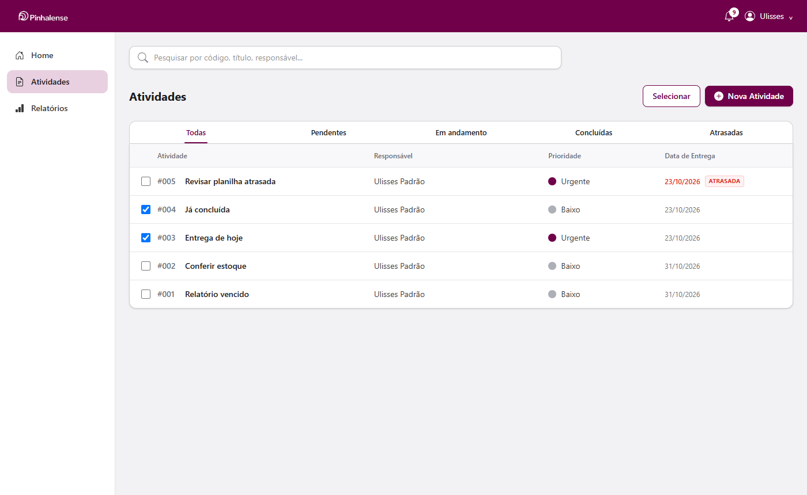
*Lista de atividades: selo "Atrasada" e prioridade Urgente*

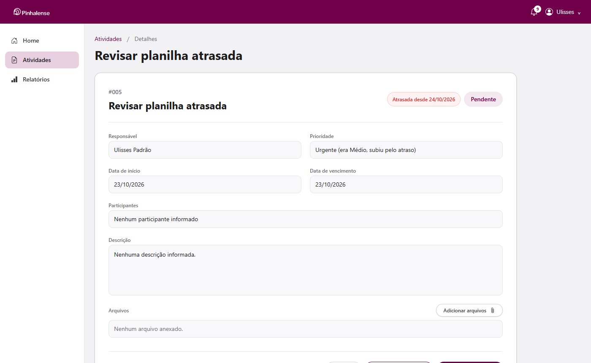
*Detalhes: desde quando está atrasada e qual era a prioridade*

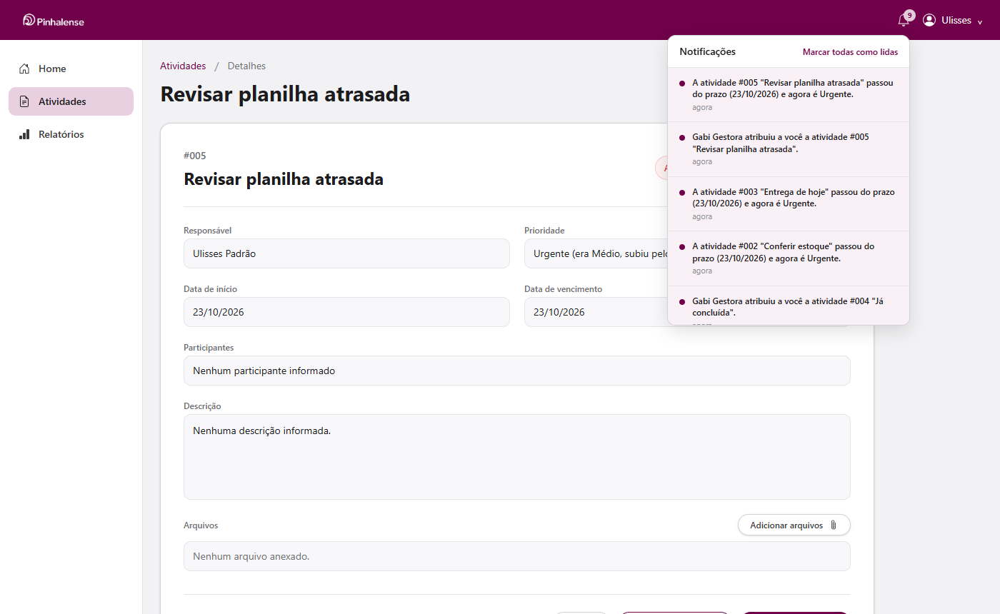
*Sino de notificações com o aviso de atraso*


## 6. Participantes vinculados a usuários

Participantes são escolhidos da lista de usuários ativos; a API guarda os ids e monta os nomes, e recusa quem não existe.

Arquivo: `backend/testes/suites/06-participantes.js` · 7.2 s

- ✔ a lista para escolher traz os ativos de todos os setores, em ordem alfabética (a inativa não aparece)
- ✔ a lista traz só id, nome e setor (sem e-mail)
- ✔ a API grava os ids (sem repetição) e monta os nomes: "Eva Engenharia, Gabi Gestora"
- ✔ id que não existe: recusado (400)
- ✔ usuário inativo: recusado (400)
- ✔ texto livre no lugar da lista: recusado (400)
- ✔ mais de 20 participantes: recusado (400)
- ✔ o campo antigo de texto livre ("participantes") é ignorado
- ✔ a gestora troca os participantes e o nome é refeito
- ✔ o usuário padrão não muda os participantes da atividade que a gestora atribuiu (403)
- ✔ tela: o responsável (ele mesmo) não aparece entre os participantes
- ✔ tela: a busca "gabi" filtra para 1 pessoa
- ✔ tela: 3 etiquetas, na ordem escolhida
- ✔ tela: o X da etiqueta tira a pessoa
- ✔ tela: a confirmação mostra "Gabi Gestora, Eva Engenharia"
- ✔ no banco ficam os ids das 2 pessoas

**Telas:**

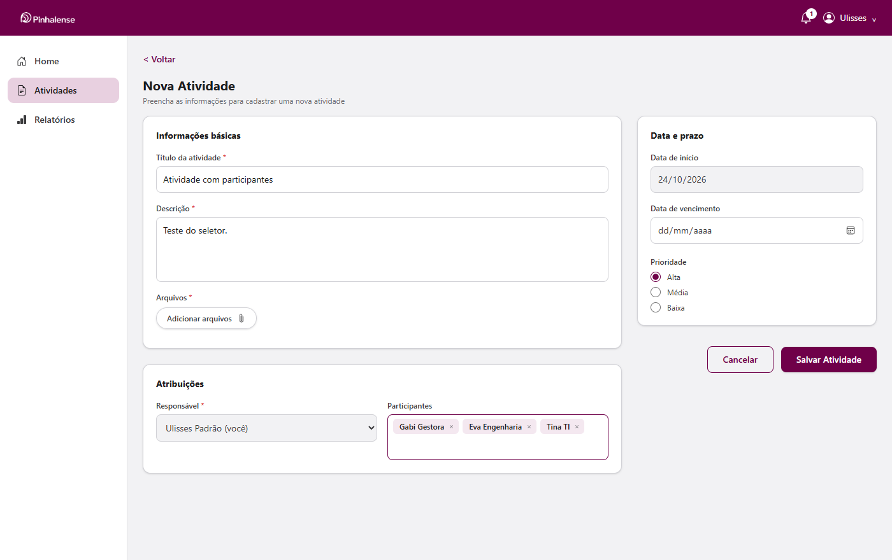
*Nova atividade: participantes escolhidos entre os usuários*


## 7. Notificações

Quem recebe uma atividade ou perde a responsabilidade por ela é avisado no sino; quem fez a ação não se auto-notifica.

Arquivo: `backend/testes/suites/07-notificacoes.js` · 5.0 s

- ✔ Ulisses: 1 aviso (a gestora atribuiu uma atividade a ele)
- ✔ gestora: nenhum aviso (ninguém é avisado do que ele mesmo fez)
- ✔ o aviso guarda o tipo, a atividade, o título e quem fez
- ✔ troca de responsável: Ursula recebe "passou para você"
- ✔ Ulisses recebe "passou a atividade para Ursula Padrão"
- ✔ a lista vem da mais recente para a mais antiga
- ✔ mudar só o status não gera aviso
- ✔ ninguém marca como lido o aviso de outra pessoa (404)
- ✔ marcar um aviso como lido baixa a contagem (2 → 1)
- ✔ sem login → 401
- ✔ tela: o sino mostra 1 não lida
- ✔ tela: a lista mostra a troca de responsável e o aviso já lido
- ✔ tela: "Marcar todas como lidas" zera o sino e grava na API
- ✔ tela: aviso novo aparece no sino sem recarregar a página
- ✔ tela: clicar no aviso abre a atividade #004 e marca como lido
- ✔ excluir o usuário apaga os avisos dele do banco

**Telas:**

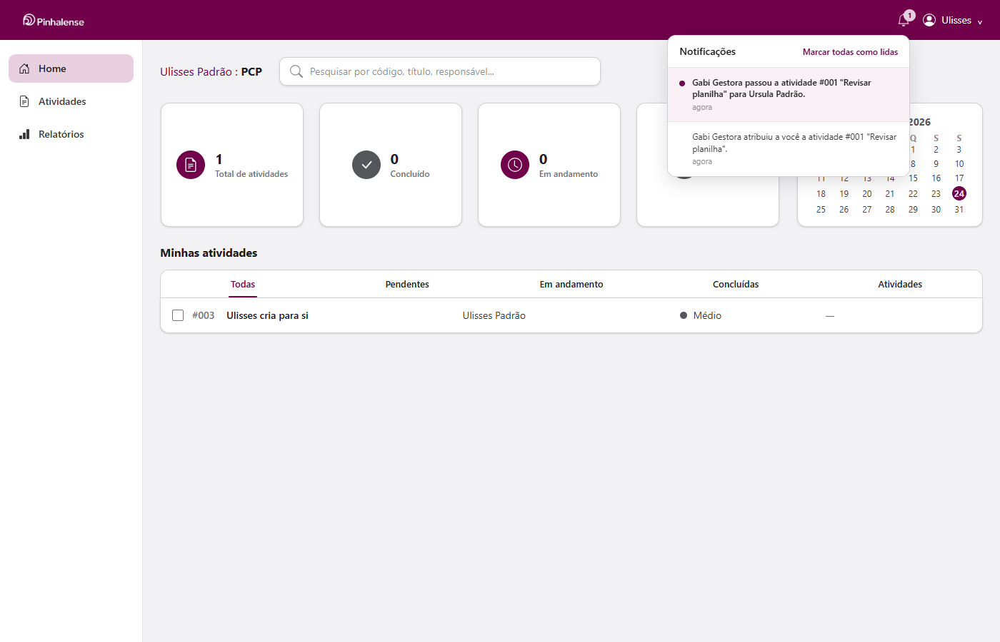
*Sino aberto: avisos de atribuição e de troca de responsável*


## 8. Meu perfil (foto e senha)

A foto vira um JPEG 256×256 e a API confere a assinatura; a troca de senha exige a atual e encerra os outros logins.

Arquivo: `backend/testes/suites/08-perfil.js` · 3.8 s

- ✔ API recusa HTML disfarçado de JPEG (assinatura)
- ✔ API só aceita JPEG
- ✔ foto com mais de 512 KB é recusada
- ✔ a senha nova precisa ser diferente da atual
- ✔ tema fora da lista (claro, escuro, profundo) é recusado
- ✔ cada pessoa vê só o próprio perfil
- ✔ tela: o menu "Meu perfil" mostra e-mail, setor e função
- ✔ tela: PNG de 3.2 MB virou um JPEG de 25 KB
- ✔ tela: a foto aparece na barra do topo (256×256) na hora
- ✔ trocar a foto apaga a antiga do Storage (sobra só a nova)
- ✔ tela: arquivo que não é imagem é recusado com aviso
- ✔ tela: senha atual errada mostra o aviso e a pessoa continua logada
- ✔ tela: confirmação diferente é recusada antes de enviar
- ✔ tela: senha alterada, aviso de sucesso e campos limpos
- ✔ o login aberto em outro aparelho cai (401)
- ✔ entra com a senha nova; a antiga não funciona
- ✔ tela: remover a foto volta o ícone na barra e apaga o arquivo

**Telas:**

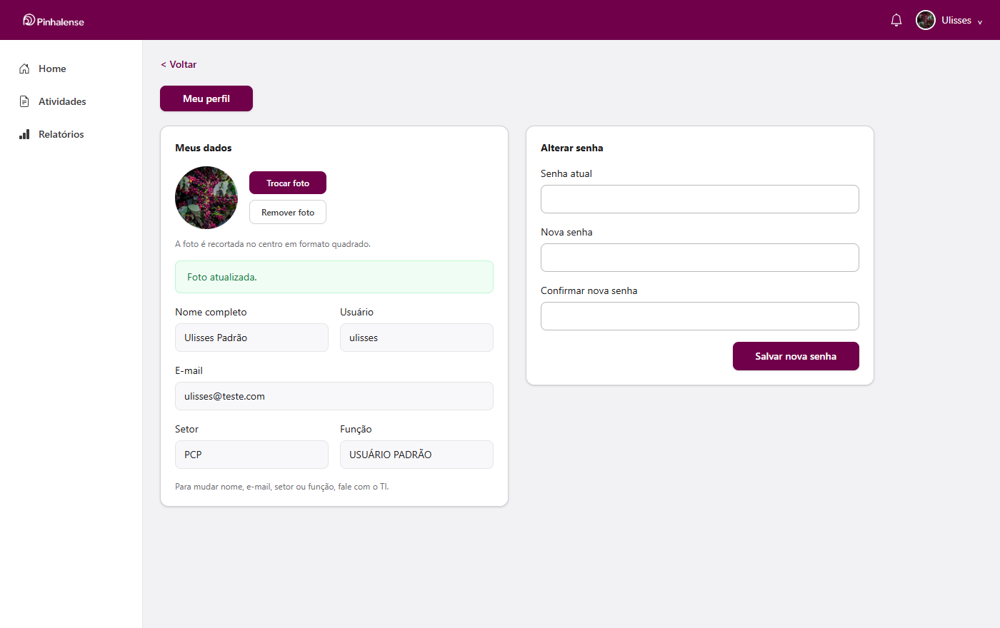
*Meu perfil: foto, e-mail, setor, função e troca de senha*


## 9. Seleção múltipla e exclusão de usuários

Ações em lote respeitam a permissão de cada atividade (as outras são ignoradas e contadas); excluir usuário preserva o histórico.

Arquivo: `backend/testes/suites/09-selecao-e-exclusao.js` · 10.6 s

- ✔ a caixinha do cabeçalho marca as 5 visíveis
- ✔ o botão mostra "Excluir (2)": só as 2 próprias podem ser excluídas
- ✔ usuário padrão não vê "Passar para"
- ✔ pede confirmação: "Excluir 2 atividade(s) e todos os arquivos delas?"
- ✔ resumo: "2 atividade(s) excluída(s). | 3 ignorada(s): seu cargo não permite essa ação nelas."
- ✔ na API: as 2 próprias sumiram, as atribuídas continuam
- ✔ no modo de seleção, clicar na linha marca a atividade (não abre os detalhes)
- ✔ resumo: "2 atividade(s) movida(s) para "Concluída"."
- ✔ na API: A1 e A2 concluídas, A3 intacta
- ✔ resumo: "2 atividade(s) passada(s) para Ursula Padrão."
- ✔ na API: A3 e G1 agora são da Ursula (id e nome atualizados juntos)
- ✔ fora do modo de seleção, clicar na linha abre os detalhes
- ✔ a confirmação avisa as 3 atividades dele e sugere "Inativo"
- ✔ ele some da lista, com o aviso de excluído
- ✔ o login aberto dele cai e ele não entra mais
- ✔ as 3 atividades dele continuam, com o nome dele, para o histórico
- ✔ a verificação de consistência aponta a atividade aberta que ficou sem responsável (as concluídas são histórico)
- ✔ clicar em "Cancelar" na confirmação não exclui
- ✔ na própria conta o botão não aparece
- ✔ gestor não exclui usuários (403)

**Telas:**

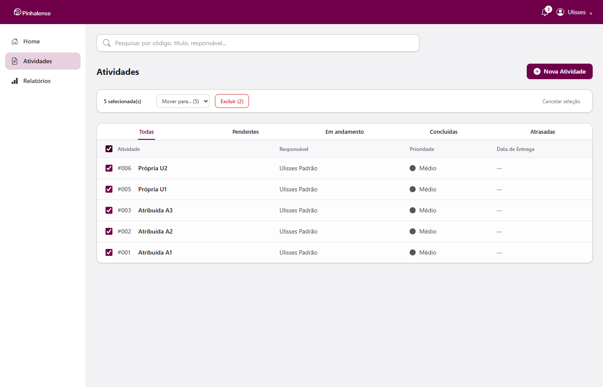
*Usuário padrão com 5 selecionadas: só 2 podem ser excluídas*

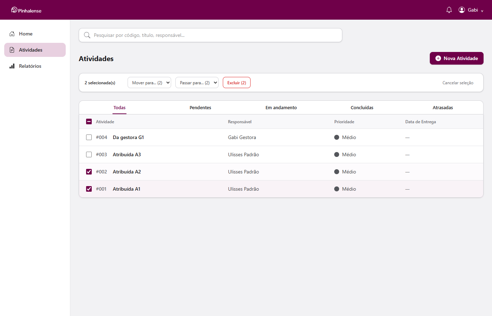
*Gestora com 2 selecionadas: mudar etapa e passar para outra pessoa*

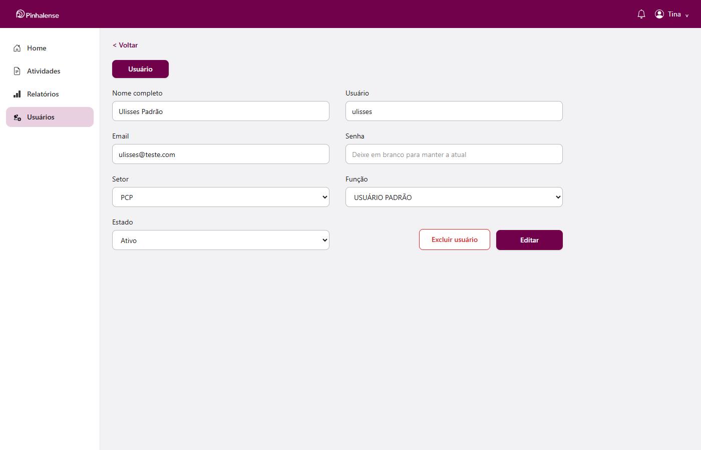
*TI editando um usuário: botão "Excluir usuário"*


## 10. Temas da interface

O tema escolhido vale na hora, fica salvo na conta e é aplicado em qualquer navegador onde a pessoa entrar.

Arquivo: `backend/testes/suites/10-temas.js` · 12.7 s

- ✔ tema "Claro" aplicado na hora
- ✔ tema "Escuro" aplicado na hora
- ✔ tema "Escuro profundo" aplicado na hora
- ✔ a conta guardou o último tema escolhido ("profundo")
- ✔ em outro navegador, o tema da conta é aplicado ao entrar
- ✔ e continua ao recarregar a página

**Telas:**

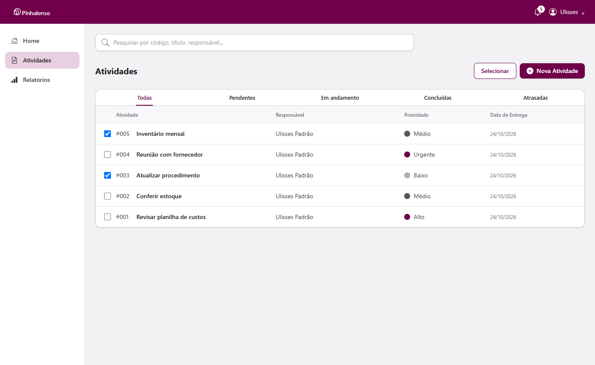
*Atividades no tema Claro*

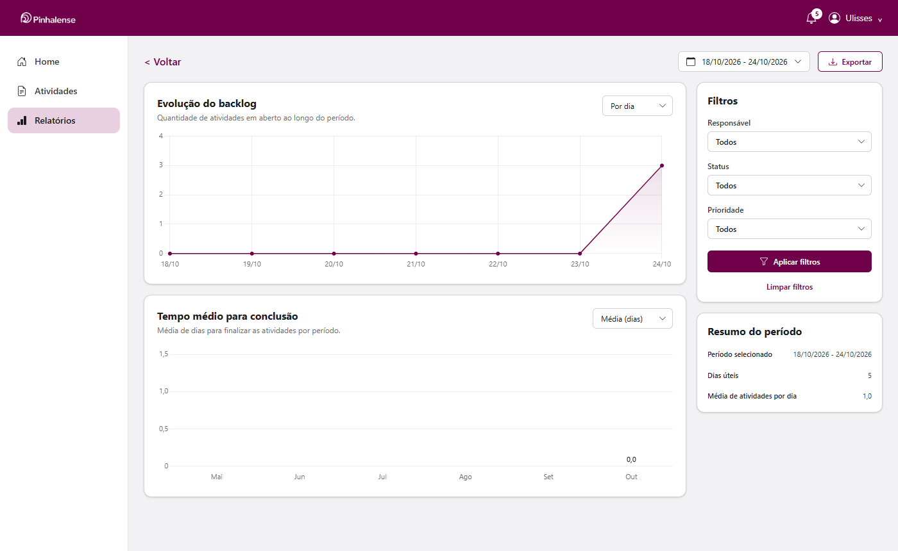
*Relatórios no tema Claro*

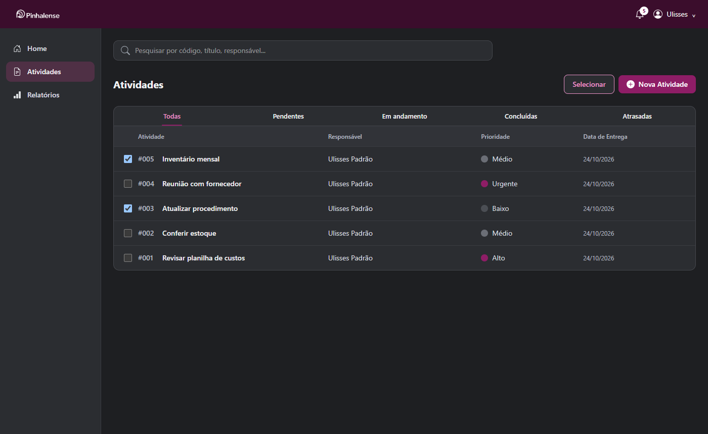
*Atividades no tema Escuro*

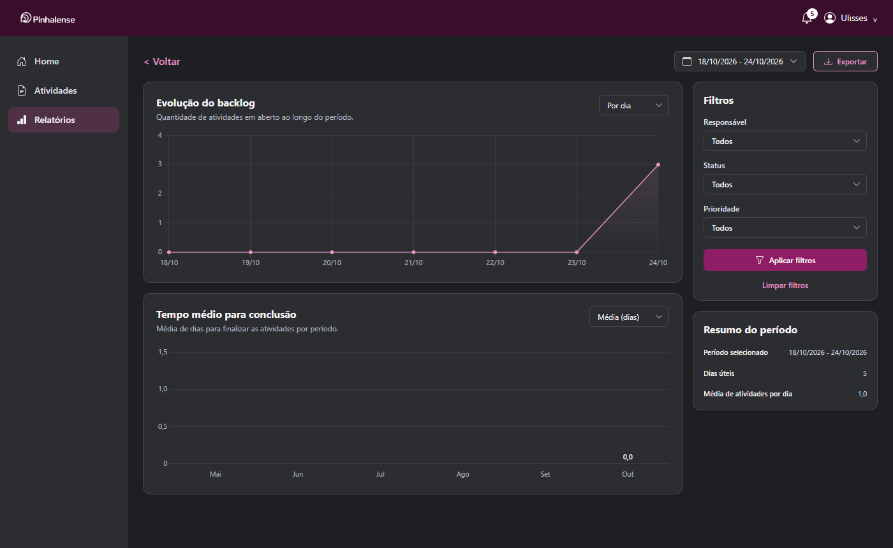
*Relatórios no tema Escuro*

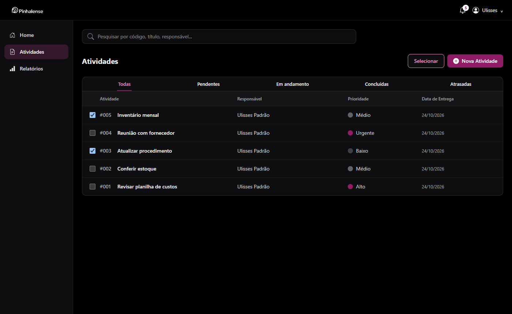
*Atividades no tema Escuro profundo*

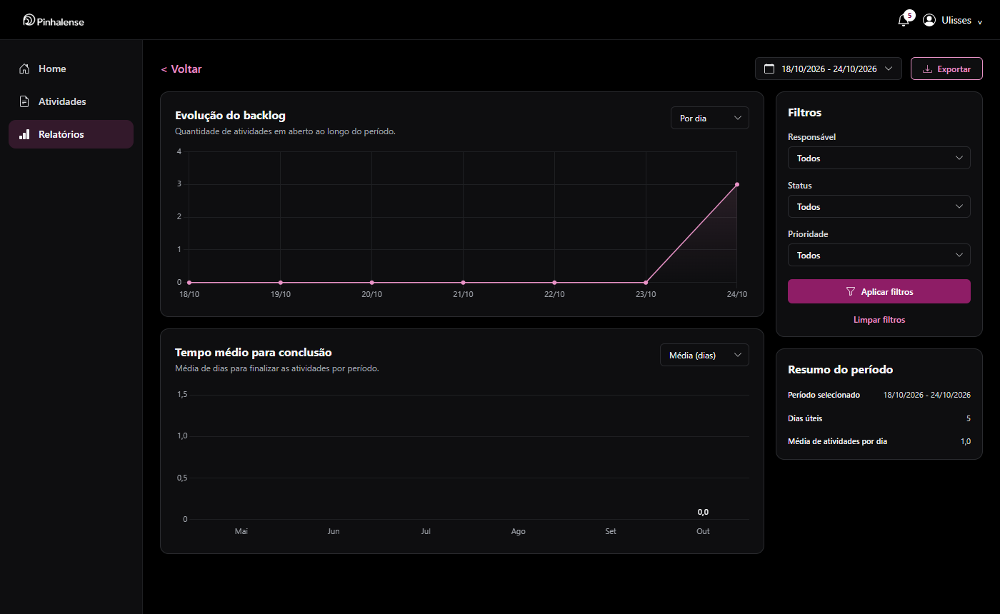
*Relatórios no tema Escuro profundo*


## 11. Verificação de consistência e correção

Dados gravados por fora da API, com 12 tipos de problema, são encontrados pelas 13 conferências e corrigidos até a verificação sair limpa.

Arquivo: `backend/testes/suites/11-consistencia.js` · 1.4 s

- ✔ a verificação roda 13 conferências
- ✔ contador_de_ids: 2 encontrado(s) (ex.: tarefas: contador 3, maior id 7)
- ✔ email_duplicado: 1 encontrado(s) (ex.: bruno@teste.com: usuários 2, 3)
- ✔ email_fora_do_padrao: 1 encontrado(s) (ex.: #2  Bruno@Teste.com )
- ✔ usuario_sem_setor: 1 encontrado(s) (ex.: #2 Bruno Sem Setor (usuario))
- ✔ tarefa_sem_responsavel: 1 encontrado(s) (ex.: #1 Importada sem responsável)
- ✔ responsavel_inexistente_ou_inativo: 1 encontrado(s) (ex.: #2 Responsável excluído)
- ✔ participante_inexistente: 1 encontrado(s) (ex.: #3 Participante excluído)
- ✔ status_ou_prioridade_invalidos: 1 encontrado(s) (ex.: #4 Status digitado errado (status "feito", prioridade "altissima"))
- ✔ datas_invertidas: 1 encontrado(s) (ex.: #5 Datas invertidas (2026-10-10 > 2026-10-01))
- ✔ prazo_vencido_sem_marcacao: 1 encontrado(s) (ex.: #6 Venceu e não marcou)
- ✔ encerrada_sem_data_de_fim: 1 encontrado(s) (ex.: #7 Concluída antiga)
- ✔ anexo_abandonado: 1 encontrado(s) (ex.: 1/nunca-terminou.pdf)
- ✔ sem_ti_ativo: 0 encontrado(s)
- ✔ 10 problemas (os 2 itens "info" não contam)
- ✔ e-mail repetido é encontrado mesmo com espaços e maiúsculas diferentes
- ✔ padronizar o e-mail do Bruno é recusado enquanto a Carla usa o mesmo (409)
- ✔ com a Carla corrigida, o e-mail do Bruno é gravado padronizado
- ✔ o valor errado não pode ser regravado pela API (400)
- ✔ datas invertidas: a nova data de início é conferida contra o vencimento já gravado
- ✔ rotina: contadores sobem até o maior id (tarefas 3 → 7, usuários 1 → 3)
- ✔ rotina: a atividade vencida virou urgente
- ✔ rotina: o envio abandonado foi apagado
- ✔ rotina: a sessão vencida foi apagada
- ✔ o próximo cadastro recebe o id 8 (sem sobrescrever a tarefa 7)
- ✔ depois das correções: 0 problemas
- ✔ sobra só o item informativo (concluída antes de existir "finalizado_em")

**Verificação ANTES da correção (GET /api/manutencao/consistencia)**

```json
{
  "totais": {
    "tarefas": 7,
    "usuarios": 3
  },
  "problemas": 10,
  "verificacoes": [
    {
      "codigo": "contador_de_ids",
      "gravidade": "erro",
      "quantidade": 2,
      "exemplos": [
        "tarefas: contador 3, maior id 7",
        "usuarios: contador 1, maior id 3"
      ],
      "acao": "A rotina diária corrige sozinha (sobe o contador até o maior id)."
    },
    {
      "codigo": "sem_ti_ativo",
      "gravidade": "erro",
      "quantidade": 0,
      "exemplos": [],
      "acao": null
    },
    {
      "codigo": "email_duplicado",
      "gravidade": "erro",
      "quantidade": 1,
      "exemplos": [
        "bruno@teste.com: usuários 2, 3"
      ],
      "acao": "Trocar o e-mail de um dos usuários na tela Usuários."
    },
    {
      "codigo": "email_fora_do_padrao",
      "gravidade": "alerta",
      "quantidade": 1,
      "exemplos": [
        "#2  Bruno@Teste.com "
      ],
      "acao": "Salvar o usuário de novo pela tela Usuários (o e-mail é normalizado ao gravar)."
    },
    {
      "codigo": "usuario_sem_setor",
      "gravidade": "alerta",
      "quantidade": 1,
      "exemplos": [
        "#2 Bruno Sem Setor (usuario)"
      ],
      "acao": "Definir o setor na tela Usuários."
    },
    {
      "codigo": "tarefa_sem_responsavel",
      "gravidade": "alerta",
      "quantidade": 1,
      "exemplos": [
        "#1 Importada sem responsável"
      ],
      "acao": "Passar para alguém em Atividades > Selecionar > Passar para."
    },
    {
      "codigo": "responsavel_inexistente_ou_inativo",
      "gravidade": "alerta",
      "quantidade": 1,
      "exemplos": [
        "#2 Responsável excluído"
      ],
      "acao": "Passar para outro responsável."
    },
    {
      "codigo": "participante_inexistente",
      "gravidade": "info",
      "quantidade": 1,
      "exemplos": [
        "#3 Participante excluído"
      ],
      "acao": "Opcional: atualizar os participantes da atividade."
    },
    {
      "codigo": "status_ou_prioridade_invalidos",
      "gravidade": "erro",
      "quantidade": 1,
      "exemplos": [
        "#4 Status digitado errado (status \"feito\", prioridade \"altissima\")"
      ],
      "acao": "Corrigir o valor pela API ou pelo Console do Firebase."
    },
    {
      "codigo": "datas_invertidas",
      "gravidade": "alerta",
      "quantidade": 1,
      "exemplos": [
        "#5 Datas invertidas (2026-10-10 > 2026-10-01)"
      ],
      "acao": "Corrigir as datas da atividade."
    },
    {
      "codigo": "prazo_vencido_sem_marcacao",
      "gravidade": "alerta",
      "quantidade": 1,
      "exemplos": [
        "#6 Venceu e não marcou"
      ],
      "acao": "Rodar a rotina diária (POST /manutencao/rotina-diaria) ou esperar as 00:05."
    },
    {
      "codigo": "encerrada_sem_data_de_fim",
      "gravidade": "info",
      "quantidade": 1,
      "exemplos": [
        "#7 Concluída antiga"
      ],
      "acao": "Nada a fazer: é histórico anterior ao campo."
    },
    {
      "codigo": "anexo_abandonado",
      "gravidade": "alerta",
      "quantidade": 1,
      "exemplos": [
        "1/nunca-terminou.pdf"
      ],
      "acao": "A rotina diária remove sozinha."
    }
  ]
}
```

**Rotina diária (POST /api/manutencao/rotina-diaria, a mesma que roda às 00:05)**

```json
{
  "contadores": {
    "tarefas": {
      "de": 3,
      "para": 7
    },
    "usuarios": {
      "de": 1,
      "para": 3
    }
  },
  "prazos": {
    "hoje": "2026-10-24",
    "abertas": 4,
    "viraram_urgentes": 1,
    "voltaram_ao_normal": 0
  },
  "anexos_abandonados": {
    "enviando": 1,
    "removidos": 1
  },
  "sessoes_vencidas": 1,
  "codigos_vencidos": 0
}
```

**Verificação DEPOIS da correção**

```json
{
  "totais": {
    "tarefas": 8,
    "usuarios": 3
  },
  "problemas": 0,
  "verificacoes": [
    {
      "codigo": "contador_de_ids",
      "gravidade": "erro",
      "quantidade": 0,
      "exemplos": [],
      "acao": null
    },
    {
      "codigo": "sem_ti_ativo",
      "gravidade": "erro",
      "quantidade": 0,
      "exemplos": [],
      "acao": null
    },
    {
      "codigo": "email_duplicado",
      "gravidade": "erro",
      "quantidade": 0,
      "exemplos": [],
      "acao": null
    },
    {
      "codigo": "email_fora_do_padrao",
      "gravidade": "alerta",
      "quantidade": 0,
      "exemplos": [],
      "acao": null
    },
    {
      "codigo": "usuario_sem_setor",
      "gravidade": "alerta",
      "quantidade": 0,
      "exemplos": [],
      "acao": null
    },
    {
      "codigo": "tarefa_sem_responsavel",
      "gravidade": "alerta",
      "quantidade": 0,
      "exemplos": [],
      "acao": null
    },
    {
      "codigo": "responsavel_inexistente_ou_inativo",
      "gravidade": "alerta",
      "quantidade": 0,
      "exemplos": [],
      "acao": null
    },
    {
      "codigo": "participante_inexistente",
      "gravidade": "info",
      "quantidade": 0,
      "exemplos": [],
      "acao": null
    },
    {
      "codigo": "status_ou_prioridade_invalidos",
      "gravidade": "erro",
      "quantidade": 0,
      "exemplos": [],
      "acao": null
    },
    {
      "codigo": "datas_invertidas",
      "gravidade": "alerta",
      "quantidade": 0,
      "exemplos": [],
      "acao": null
    },
    {
      "codigo": "prazo_vencido_sem_marcacao",
      "gravidade": "alerta",
      "quantidade": 0,
      "exemplos": [],
      "acao": null
    },
    {
      "codigo": "encerrada_sem_data_de_fim",
      "gravidade": "info",
      "quantidade": 1,
      "exemplos": [
        "#7 Concluída antiga"
      ],
      "acao": "Nada a fazer: é histórico anterior ao campo."
    },
    {
      "codigo": "anexo_abandonado",
      "gravidade": "alerta",
      "quantidade": 0,
      "exemplos": [],
      "acao": null
    }
  ]
}
```

## 12. Importação de planilha CSV

Cada linha da planilha é convertida para o formato do sistema e conferida; as inválidas são recusadas com o motivo e as repetidas não duplicam.

Arquivo: `backend/testes/suites/12-importacao-csv.js` · 3.7 s

- ✔ UTF-8 com BOM (Excel "CSV UTF-8"): o BOM é removido
- ✔ Windows-1252 (Excel "CSV" em português): acentos lidos certo
- ✔ separador ";" detectado, cabeçalho com acento reconhecido, aspas com ";", quebra de linha e aspas dobradas
- ✔ " Concluída " → concluido, "ALTA" → alto, 05/03/2026 → 2026-03-05, "maria souza" ligado ao usuário #5
- ✔ campos vazios: pendente, medio e null
- ✔ responsável inativo: fica só o nome, com aviso
- ✔ recusada: título vazio ("título vazio")
- ✔ recusada: título com 151 caracteres ("titulo com mais de 150 caracteres")
- ✔ recusada: status desconhecido ("status "talvez" não é válido (use: pendente, em andamento, concluido, cancelado)")
- ✔ recusada: prioridade desconhecida ("prioridade "altíssima" não é válido (use: baixo, medio, alto, urgente)")
- ✔ recusada: data que não existe (31/02) ("data_conclusao "31/02/2026" não é uma data válida")
- ✔ recusada: vencimento antes do início ("a data de vencimento não pode ser antes da data de início")
- ✔ --simular: mostra que 3 seriam importadas e não grava nada
- ✔ importação: 3 importadas, 3 recusadas com o motivo e o número da linha
- ✔ no banco: acentos certos, ";" dentro de aspas, status/prioridade/datas convertidos e responsável ligado à Maria (#2)
- ✔ prazo vencido na planilha: a atividade já entra Urgente (regra do prazo aplicada na importação)
- ✔ "Equipe" não é usuário: fica só o nome (a verificação de consistência aponta)
- ✔ importar o mesmo arquivo de novo não duplica (3 já existiam)
- ✔ os ids da importação seguem o contador: a próxima atividade é a #4

**Saída do importador (npm run importar:csv)**

```json
[
  "Lendo C:\\Users\\icaro\\AppData\\Local\\Temp\\expresso-teste-1792861375649.csv",
  "6 linha(s), separador \";\". Destino: Firestore demo-expresso (emulador em 127.0.0.1:8080)",
  "  linha 2: importada como #1",
  "  linha 3: importada como #2",
  "  linha 4: importada como #3 (aviso: responsável \"Equipe\" não é um usuário ativo: ficou só o nome)",
  "  linha 5: RECUSADA - título vazio",
  "  linha 6: RECUSADA - status \"talvez\" não é válido (use: pendente, em andamento, concluido, cancelado)",
  "  linha 7: RECUSADA - a data de vencimento não pode ser antes da data de início",
  "",
  "Importação concluída: 3 importadas, 3 recusadas, 0 já existiam, 1 aviso(s).",
  "[CSV] {\"arquivo\":\"expresso-teste-1792861375649.csv\",\"simular\":false,\"importadas\":3,\"recusadas\":3,\"repetidas\":0,\"avisos\":1}"
]
```

## 13. Migração MySQL → Firestore

Os dados do backend antigo entram com os mesmos ids, senhas e datas; o que não fecha é avisado ou impede a gravação (tudo ou nada).

Arquivo: `backend/testes/suites/13-migracao-mysql.js` · 1.9 s

- ✔ e-mail que existe nos dois bancos (comparado sem maiúsculas): erro
- ✔ status desconhecido: erro
- ✔ data que não existe (30/02): erro
- ✔ plano com erro não grava nada (tudo ou nada)
- ✔ dados de exemplo sem erros que impeçam a migração
- ✔ e-mail padronizado em minúsculas (com aviso)
- ✔ senha curta mantida, com aviso para trocar (não bloqueia o acesso)
- ✔ responsável sem id ligado ao usuário pelo nome
- ✔ responsável que não existe mais: fica só o nome
- ✔ participante de texto livre que não é usuário: avisado
- ✔ datas invertidas no histórico: mantidas, com aviso
- ✔ a Tina, que já estava no Firestore como #1, muda para #8 (o #1 é do MySQL)
- ✔ o login aberto da Tina com o id antigo é encerrado (o #1 agora é outra pessoa)
- ✔ a Tina entra com o mesmo login e senha, agora como #8
- ✔ usuários do MySQL entram com as senhas de antes
- ✔ setor "pcp" → "PCP"; a coluna antiga "cargo" e a data de cadastro são preservadas
- ✔ as tarefas mantêm os ids do MySQL (2, 3, 4, 5, 6, 9)
- ✔ datas de criação e de conclusão preservadas
- ✔ "Cancelado " e "Alto" padronizados; responsável ligado ao #2 com o nome do cadastro
- ✔ participantes: o nome que é usuário vira id; o texto original fica no histórico
- ✔ aberta com prazo vencido: entra Urgente
- ✔ descrição vazia ("") vira null
- ✔ os contadores continuam do maior id: próxima tarefa #10, próximo usuário #9
- ✔ nenhum problema grave depois da migração; os alertas (ex.: atividades sem responsável) ficam listados para a equipe

**Erros que impedem a migração (dados de exemplo com problemas)**

```json
[
  "o e-mail tina@teste.com existe nos dois bancos (Firestore #1 e MySQL #8)",
  "tarefa MySQL #10: status desconhecido \"feito\"",
  "tarefa MySQL #10: data_inicio inválida \"2025-02-30\""
]
```

**Avisos da migração (gravados, para corrigir depois)**

```json
[
  "usuário MySQL #1: e-mail \"Admin@PI.com\" gravado como \"admin@pi.com\"",
  "usuário MySQL #7: senha com menos de 6 caracteres (mantida para não bloquear o acesso; peça para trocar em \"Meu perfil\")",
  "tarefa MySQL #3: responsável \"usuário teste\" ligado ao usuário #2 pelo nome",
  "tarefa MySQL #4: sem responsável vinculado (só o TI vai enxergar até alguém assumir)",
  "tarefa MySQL #4: participante \"Pessoa de Fora\" não é um usuário; fica só no texto",
  "tarefa MySQL #5: responsável #5 não existe no MySQL; ficou só o nome \"Ex-funcionário\"",
  "tarefa MySQL #5: sem responsável vinculado (só o TI vai enxergar até alguém assumir)",
  "tarefa MySQL #6: vencimento (2025-10-01) antes do início (2025-10-10); mantido como veio"
]
```

**Verificação de consistência logo depois da migração**

```json
[
  {
    "codigo": "usuario_sem_setor",
    "gravidade": "alerta",
    "quantidade": 2,
    "exemplos": [
      "#1 Administrador (gestor)",
      "#9 Novo (usuario)"
    ]
  },
  {
    "codigo": "tarefa_sem_responsavel",
    "gravidade": "alerta",
    "quantidade": 2,
    "exemplos": [
      "#4 Reunião com o cliente",
      "#5 Rotas da API"
    ]
  },
  {
    "codigo": "datas_invertidas",
    "gravidade": "alerta",
    "quantidade": 1,
    "exemplos": [
      "#6 Datas digitadas trocadas (2025-10-10 > 2025-10-01)"
    ]
  },
  {
    "codigo": "encerrada_sem_data_de_fim",
    "gravidade": "info",
    "quantidade": 2,
    "exemplos": [
      "#3 Modelagem do banco",
      "#6 Datas digitadas trocadas"
    ]
  }
]
```

## 14. Gravação de ponta a ponta na Cloud Function

O que é enviado à API é o que fica gravado no Firestore e no Storage, e a exclusão apaga tudo (roteiro npm run testar).

Arquivo: `backend/testes/suites/14-ponta-a-ponta.js` · 1.0 s

- ✔ API no ar, banco "Firestore demo-expresso (emulador em 127.0.0.1:8080)" conectado (hora do banco: 2026-10-24T17:03:01.280Z)
- ✔ Logado como Tina TI (ti)
- ✔ Servidor aceitou e devolveu id 1
- ✔ titulo gravado
- ✔ responsável = quem criou
- ✔ participantes gravado (pelo nome do usuário)
- ✔ prioridade gravada (veio: alto)
- ✔ data_inicio gravada (veio: 2026-10-24)
- ✔ data_conclusao gravada (veio: 2026-11-07)
- ✔ status atualizado
- ✔ arquivo enviado ao Storage (status 200)
- ✔ anexo confirmado na tarefa
- ✔ download do arquivo confere com o enviado
- ✔ anexo aparece na lista da tarefa
- ✔ tarefa de teste removida
- ✔ arquivo apagado do Storage junto com a tarefa (link agora responde 403)
- ✔ roteiro terminou com código 0 (16 checagens)
